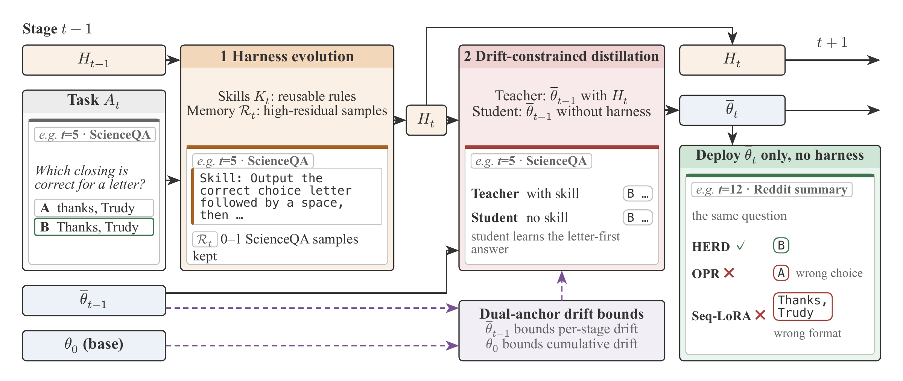
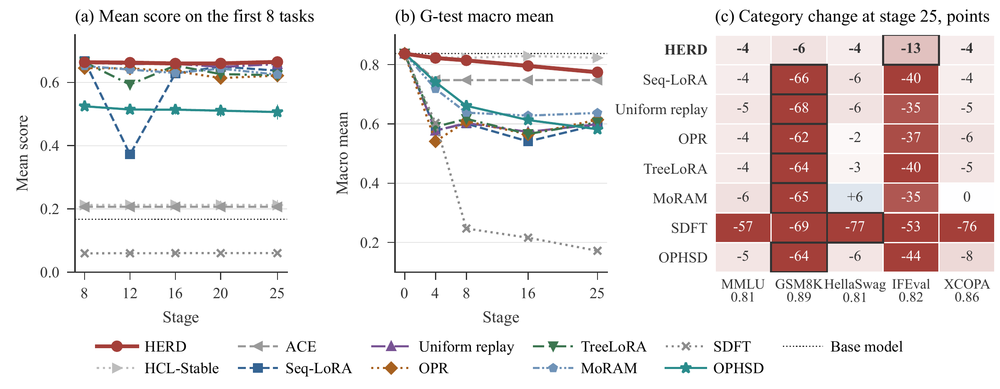

<div align="center">

<h1>HERD</h1>
<h3>Harness-Evolving Recursive Distillation<br>for Continual Learning</h3>

<p><strong>Learn in the harness. Internalize in the weights.</strong></p>
<p>Continual learning through evolving skills, residual memory,<br>and dual-anchor distillation.</p>

<p>
  <a href="#overview">Overview</a> &nbsp;·&nbsp;
  <a href="#method">Method</a> &nbsp;·&nbsp;
  <a href="#results">Results</a> &nbsp;·&nbsp;
  <a href="#getting-started">Getting started</a> &nbsp;·&nbsp;
  <a href="#compute-accounting">Compute</a>
</p>

<p><sub>Anonymous research submission · Qwen3.5-4B · TRACE+17 · 25 sequential tasks</sub></p>

</div>

---

## Overview

HERD learns reusable skills in a harness and distills them into model weights. A bounded memory retains records the model still predicts poorly; two anchors constrain drift from the previous checkpoint and the base model.

<table>
  <thead>
    <tr>
      <th align="center">Final task performance ↑</th>
      <th align="center">New-task acquisition ↑</th>
      <th align="center">Forgetting ↓</th>
      <th align="center">Added inference context</th>
    </tr>
  </thead>
  <tbody>
    <tr>
      <td align="center"><strong>0.706</strong><br><sub>AA after stage 25</sub></td>
      <td align="center"><strong>0.713</strong><br><sub>Mean score when learned</sub></td>
      <td align="center"><strong>0.010</strong><br><sub>Acquisition-to-final loss</sub></td>
      <td align="center"><strong>0 tokens</strong><br><sub>Merged weights only</sub></td>
    </tr>
  </tbody>
</table>

<p align="center"><sub>TRACE+17 · Means over seeds 42, 43, and 44.</sub></p>

<p align="center">
  
  <br><sub>One HERD stage, with a ScienceQA example learned at stage 5 and tested again at stage 12.</sub>
</p>

## Method

<table>
  <thead>
    <tr><th>Component</th><th>Role in the recursive loop</th></tr>
  </thead>
  <tbody>
    <tr>
      <td><strong>Harness evolution</strong><br>K<sub>t</sub></td>
      <td>The frozen base proposes a routed skill from current-task records and checkpoint mistakes. A residual-based guard checks the updated registry.</td>
    </tr>
    <tr>
      <td><strong>Residual memory</strong><br>R<sub>t</sub></td>
      <td>Retain whole high-residual records and rescore them after each merge. Earlier records supply checkpoint-anchor probes, not replay targets.</td>
    </tr>
    <tr>
      <td><strong>Recursive distillation</strong><br>Harness → weights</td>
      <td>The previous checkpoint sees the skill and verified answer; a fresh LoRA student sees the bare prompt. Match their full-vocabulary distributions on answer prefixes, then merge the adapter.</td>
    </tr>
    <tr>
      <td><strong>Dual anchors</strong><br>Checkpoint + base</td>
      <td>The previous checkpoint limits per-stage drift on retained tasks; the frozen base limits cumulative drift on general probes. Dual ascent adjusts both multipliers.</td>
    </tr>
  </tbody>
</table>

Carry the harness and merged weights to the next stage. Deploy the weights alone.

<details>
<summary><strong>Objective and drift constraints</strong></summary>

Minimize token-averaged forward KL from teacher to student on verified-answer prefixes, rather than on-policy rollouts.

Each anchor measures the **worst group's mean KL** over the first 32 greedy response tokens. Group checkpoint probes by task and general probes by source; both budgets are 0.05. These probe constraints do not guarantee zero forgetting.

</details>

## Results

HERD has the highest mean AA in this comparison, though the paired 95% interval for its AA difference from uniform replay includes zero. Acquisition is statistically indistinguishable from Seq-LoRA. General-capability loss is the smallest among weight-updating methods: **ΔC = −0.063**, with a worst-category change of **−0.130**.

<p align="center">
  
  <br><sub>Error bars: one standard deviation over three seeds. Category changes are in points.</sub>
</p>

<details>
<summary><strong>Full comparison · TRACE+17 after stage 25</strong></summary>

<table>
  <thead>
    <tr><th>Method</th><th>Family</th><th>AA ↑</th><th>Acq. ↑</th><th>F ↓</th><th>G-test ↑</th><th>ΔC ↑</th><th>ΔC<sub>min</sub> ↑</th></tr>
  </thead>
  <tbody>
    <tr><td><strong>HERD</strong></td><td>Hybrid · this work</td><td><strong>0.706</strong></td><td>0.713</td><td>0.010</td><td>0.774</td><td>−0.063</td><td>−0.130</td></tr>
    <tr><td>Base</td><td>Control</td><td>0.419</td><td>0.419</td><td>0.000</td><td>0.837</td><td>0.000</td><td>0.000</td></tr>
    <tr><td>Static harness</td><td>Control</td><td>0.432</td><td>0.432</td><td>0.000</td><td>0.791</td><td>−0.046</td><td>−0.135</td></tr>
    <tr><td>HCL-Stable</td><td>Non-parametric</td><td>0.433</td><td>0.435</td><td>0.003</td><td>0.823</td><td>−0.014</td><td>−0.085</td></tr>
    <tr><td>ACE</td><td>Non-parametric</td><td>0.427</td><td>0.428</td><td>0.001</td><td>0.748</td><td>−0.089</td><td>−0.320</td></tr>
    <tr><td>Seq-LoRA</td><td>Parametric</td><td>0.694</td><td>0.715</td><td>0.025</td><td>0.597</td><td>−0.240</td><td>−0.665</td></tr>
    <tr><td>Uniform replay</td><td>Parametric</td><td>0.699</td><td>0.711</td><td>0.020</td><td>0.599</td><td>−0.238</td><td>−0.675</td></tr>
    <tr><td>OPR</td><td>Parametric</td><td>0.690</td><td>0.705</td><td>0.024</td><td>0.614</td><td>−0.223</td><td>−0.625</td></tr>
    <tr><td>TreeLoRA</td><td>Parametric</td><td>0.686</td><td>0.711</td><td>0.032</td><td>0.605</td><td>−0.232</td><td>−0.635</td></tr>
    <tr><td>MoRAM</td><td>Parametric</td><td>0.693</td><td>0.701</td><td>0.019</td><td>0.637</td><td>−0.200</td><td>−0.650</td></tr>
    <tr><td>SDFT</td><td>Parametric</td><td>0.021</td><td>0.024</td><td>0.003</td><td>0.172</td><td>−0.665</td><td>−0.770</td></tr>
    <tr><td>OPHSD</td><td>Hybrid</td><td>0.620</td><td>0.639</td><td>0.021</td><td>0.582</td><td>−0.255</td><td>−0.645</td></tr>
  </tbody>
</table>

**Metrics.** AA: final mean over 25 tasks. Acq.: mean score at acquisition. F: mean nonnegative acquisition-to-final drop over tasks 1–24. G-test: macro mean over five categories. ΔC and ΔC<sub>min</sub>: mean and worst-category changes from the base. Scores are on a 0–1 scale; values are manuscript means.

**Baseline context.** In these runs, SDFT collapses, so its low F does not indicate retention. ACE hits the input ceiling and rolls back later updates; HCL-Stable accepts no proposals. Results apply to these implementations and budgets.

</details>

### Evaluation protocol

| Item | Configuration |
| --- | --- |
| Base model | Qwen3.5-4B; pinned checkpoint revision in the runners |
| Task stream | TRACE+17: 8 TRACE tasks followed by 17 Super-NaturalInstructions tasks |
| Splits | Target: 500 train / 100 validation / 100 test per task; see the release data note below for NumGLUE-cm resampling |
| General-capability test | 1,000 held-out items: 200 each from MMLU, GSM8K, HellaSwag, IFEval, and XCOPA |
| Update budget | 32 updates × 32 records per stage for weight-updating methods |
| Main-run seeds | 42, 43, 44; mean and sample standard deviation |
| Full evaluation | All seen tasks and full G-test after stages 4, 8, 16, and 25; current-task evaluation after every stage |
| Retention panels | Tasks 1–8 additionally at stages 12 and 20; a 200-item G-test subset at non-anchor stages |
| Test decoding | Greedy, thinking off; at most 16,384 input and 5,120 generated tokens |
| Uncertainty | 95% item-bootstrap intervals with 4,000 draws, resampled within task or category |

General-anchor training probes are disjoint from G-test. Main comparisons use three seeds; ablations use one. Evaluation covers one base model and one task order; some forgetting and general-capability loss remain.

## Getting started

Run commands from the **code repository root**. Package names and CLI paths use `hero`.

### 1. Set up the workspace

Requires **Node.js ≥22.19.0**, **pnpm 11.12.0**, **Python 3.12**, and **uv**. GPU bundles pin their CUDA dependencies separately.

```sh
cp .env.example .env
# Replace this path with the source directory described in .env.example.
export HERO_TRACE_SOURCE_ROOT=/path/to/raw
pnpm install --frozen-lockfile
pnpm build
```

<details>
<summary><strong>Focused verification commands</strong></summary>

Run the checks for the component you changed:

```sh
pnpm test          # TypeScript workspace tests
pnpm eval:test     # Shared Python scorers
pnpm opd:test      # Distillation runtime and stream tests
pnpm opd:validate  # Python source compilation checks
pnpm analysis:test # Statistical analysis and data preparation tests
```

These checks do not run GPU training. See the DSH section for integration checks.

</details>

### 2. Prepare the model and data

Follow `datasets/trace-plus-17/README.md` for source revisions, directory layout, and dataset terms. Prepare the model first: the builder needs its tokenizer.

```sh
pnpm model:setup
pnpm dataset:build
pnpm dataset:verify
```

**Dataset v1.1.** All tasks have 500/100/100 records. NumGLUE-cm expands 256/48 training/validation prompts by deterministic within-split sampling with replacement; its 100 test records stay unchanged. Repeats have unique IDs and `metadata.resampledFrom`. JSONL files remain local. Use the same manifest across methods: v1.1 changes sample multiplicities and requires new runs, separate from prior artifacts and the reported paper results.

Also prepare G-test, reserved general probes, and scorer assets as described in `experiments/protocol.md` and the stream README; `dataset:build` covers TRACE+17 only.

### 3. Configure and run an experiment

```sh
uv run --locked --project packages/hero-drift-constrained-opd/python --python 3.12 \
  python packages/hero-drift-constrained-opd/stream/run.py prepare --help
uv run --locked --project packages/hero-drift-constrained-opd/python --python 3.12 \
  python packages/hero-drift-constrained-opd/stream/run.py stream --help
```

The CLI provides `prepare` (bundle), `stream` (GPU run), `report` (validation), and `score` (test scoring). See `packages/hero-drift-constrained-opd/stream/README.md` for execution and cluster submission. Set `--split test` when preparing a run for the formal test schedule.

<details>
<summary><strong>Paper configuration</strong></summary>

CLI defaults differ from the paper. Set these parameters explicitly and save `plan.json` with each run.

| Parameter | Paper setting |
| --- | --- |
| Stages | 25 |
| LoRA rank / alpha / dropout | 32 / 64 / 0 |
| Updates / records per update | 32 / 32 |
| Learning rate | 1e-4, linearly decayed to zero |
| Training sequence limit | 16,384 tokens |
| Current-task evidence window | 8,192 tokens |
| Skill registry / individual skill | 24,576 / 768 tokens |
| Memory budget | 32,768 tokens, including 8,192 reserved for general probes |
| Checkpoint probes | Up to 8 per retained task; first 32 greedy tokens |
| Checkpoint / base drift budgets | 0.05 / 0.05 |
| Dual-ascent rate | 0.5 |

Check the saved plan against the manuscript. Baseline entry points and dependencies are in `packages/baselines/README.md`.

</details>

### 4. Score and analyze results

Decode and score with the method runner, then analyze its scored item panels:

```sh
python3 experiments/code/summarize.py /path/scored-panels.json \
  --reference /path/baseline-panels.json --output output/comparison.json
```

Input: `taskOrder` and `runs`, with `learned`, `final`, `generalBase`, and `generalFinal` panels per seed. Each panel maps tasks or categories to `{item_id: score}`. Keep failed predictions as zero; match item IDs and manifests across methods. Omit `--reference` for a single method. See `experiments/code/README.md` for the schema.

Outputs include stream metrics, seed means, sample SD, and 95% item-bootstrap intervals (4,000 draws). Seeds remain fixed: intervals measure item-sampling uncertainty, not training-seed uncertainty.

This release excludes published result payloads, predictions, checkpoints, and run archives. Runners and analysis write local outputs; the results above come from the manuscript.

### 5. Open the local DSH interface

To open the optional DeepSeek Harness (DSH) console:

```sh
pnpm model:setup  # Download the pinned model if it is not already available.
pnpm dsh:web
```

`dsh:web` installs the plugin and starts the host. Open <http://127.0.0.1:3080/hero/>. Model bridge: <http://127.0.0.1:8192/v1>.

Optional checks: `pnpm model:smoke` and `pnpm dsh:smoke`. They require the model/host environment; the model smoke runs inference.

## Code layout

| Path | Purpose |
| --- | --- |
| `packages/hero-drift-constrained-opd/stream/` | HERD algorithm, bundle runner, training, and evaluation |
| `packages/hero-harness-evolving/` | Harness evolution components |
| `packages/hero-dsh-plugin/`, `apps/console/` | Local DSH plugin and console |
| `packages/baselines/` | Comparison methods and implementation provenance |
| `packages/evaluator/` | Shared evaluation contracts and scorers |
| `packages/hero-data-preprocessing/` | Dataset construction tools |
| `config/datasets/` | Dataset selection and source configuration |
| `datasets/trace-plus-17/` | Pinned dataset manifests, realized split counts, and hashes |
| `experiments/protocol.md` | Shared experimental protocol |
| `experiments/code/` | Statistical analysis of scored item panels |

## Citation and attribution

**HERD: Harness-Evolving Recursive Distillation for Continual Learning**. Anonymous submission, 2026; author and publication details are withheld for review.

Attribution and reuse terms are in the dataset manifests, baseline provenance records, `UPSTREAM.json` where present, and license files. Third-party code and datasets retain their original terms.

For issues, include the method, seed, plan, code revision, and error log. Remove credentials and private infrastructure details.

## Compute accounting

<p><strong>Compute record.</strong> Measured from the sealed per-item timing ledgers of the reported runs. Each row covers one full 25-stage run of one seed on a single device.</p>

**GPU-hours = GPU count × elapsed hours**, summed over the listed runs. Learning/update time includes harness proposals, rollouts, and distillation; evaluation is reported separately. Timings are device wall-clock busy time for the listed hardware and are not hardware-normalized.

<table>
  <thead>
    <tr>
      <th>Method</th>
      <th>Compute infrastructure</th>
      <th>Accelerator × count<br>Memory per device</th>
      <th>Runs / seeds included</th>
      <th>Learning / update<br>GPU-hours</th>
      <th>Evaluation<br>GPU-hours</th>
      <th>Total<br>GPU-hours</th>
    </tr>
  </thead>
  <tbody>
    <tr><td><strong>HERD</strong></td><td>GPU cluster</td><td>NVIDIA H200 ×1<br>141 GB</td><td>Seed 42</td><td>5.2</td><td>14.2</td><td>19.4</td></tr>
    <tr><th colspan="7" align="left">Non-parametric baselines</th></tr>
    <tr><td>HCL-Stable</td><td>Local workstation</td><td>Apple M4 Max GPU (32-core) ×1<br>128 GB unified memory</td><td>Seed 42</td><td>35.3</td><td>48.0</td><td>83.3</td></tr>
    <tr><td>ACE</td><td>Local workstation</td><td>Apple M4 Max GPU (32-core) ×1<br>128 GB unified memory</td><td>Seed 42</td><td>24.7</td><td>118.4</td><td>143.1</td></tr>
    <tr><th colspan="7" align="left">Parametric baselines</th></tr>
    <tr><td>Seq-LoRA</td><td>GPU cluster</td><td>NVIDIA H200 ×1<br>141 GB</td><td>Seed 42</td><td>2.9</td><td>16.6</td><td>19.5</td></tr>
    <tr><td>Uniform replay</td><td>GPU cluster</td><td>NVIDIA H200 ×1<br>141 GB</td><td>Seed 42</td><td>4.2</td><td>20.0</td><td>24.2</td></tr>
    <tr><td>OPR</td><td>GPU cluster</td><td>NVIDIA H200 ×1<br>141 GB</td><td>Seed 42</td><td>5.1</td><td>4.9</td><td>10.0</td></tr>
    <tr><td>TreeLoRA</td><td>GPU cluster</td><td>NVIDIA H200 ×1<br>141 GB</td><td>Seed 42</td><td>3.5</td><td>18.4</td><td>21.9</td></tr>
    <tr><td>MoRAM</td><td>GPU cluster</td><td>NVIDIA H200 ×1<br>141 GB</td><td>Seed 42</td><td>1.5</td><td>17.2</td><td>18.7</td></tr>
    <tr><td>SDFT</td><td>GPU cluster</td><td>NVIDIA H200 ×1<br>141 GB</td><td>Seed 42</td><td>15.5</td><td>2.6</td><td>18.1</td></tr>
    <tr><th colspan="7" align="left">Hybrid baseline</th></tr>
    <tr><td>OPHSD</td><td>GPU cluster</td><td>NVIDIA H200 ×1<br>141 GB</td><td>Seed 42</td><td>83.0</td><td>8.6</td><td>91.6</td></tr>
    <tr><th colspan="7" align="left">Controls</th></tr>
    <tr><td>Base</td><td>GPU cluster</td><td>NVIDIA A100-PCIE-40GB ×1<br>40 GB</td><td>Single run</td><td>0.0</td><td>3.4</td><td>3.4</td></tr>
    <tr><td>Static harness</td><td>GPU cluster</td><td>NVIDIA A100-PCIE-40GB ×1<br>40 GB</td><td>Single run</td><td>0.0</td><td>10.6</td><td>10.6</td></tr>
  </tbody>
</table>

<sub>**Notes.** Rows are single-seed accounting for one complete 25-stage run; the main comparison was run for three seeds (42, 43, 44), so the three-seed compute bill is three times each main row, about 1,350 GPU-hours across the reported experiments.</sub>
